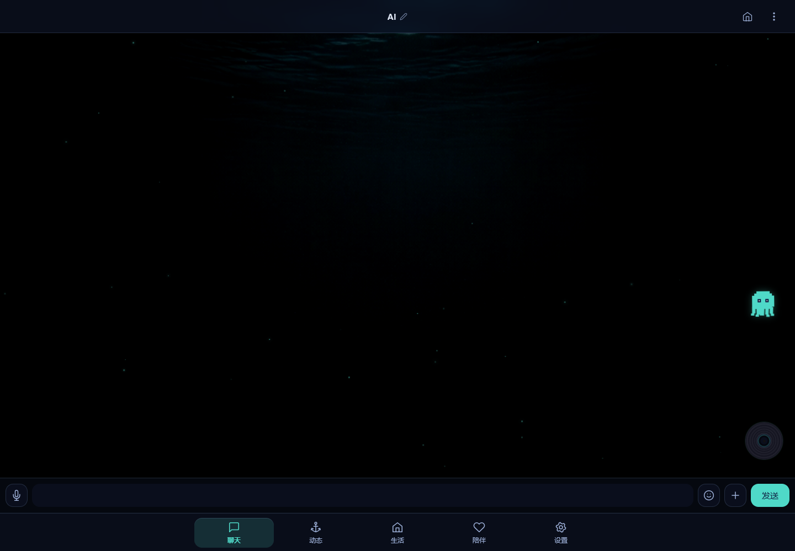
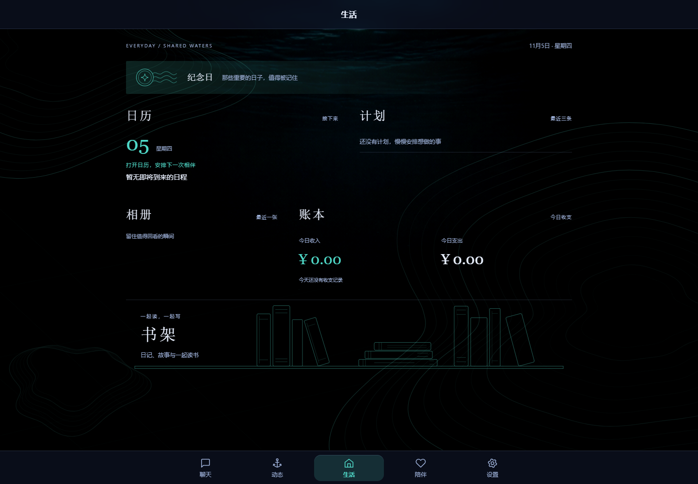
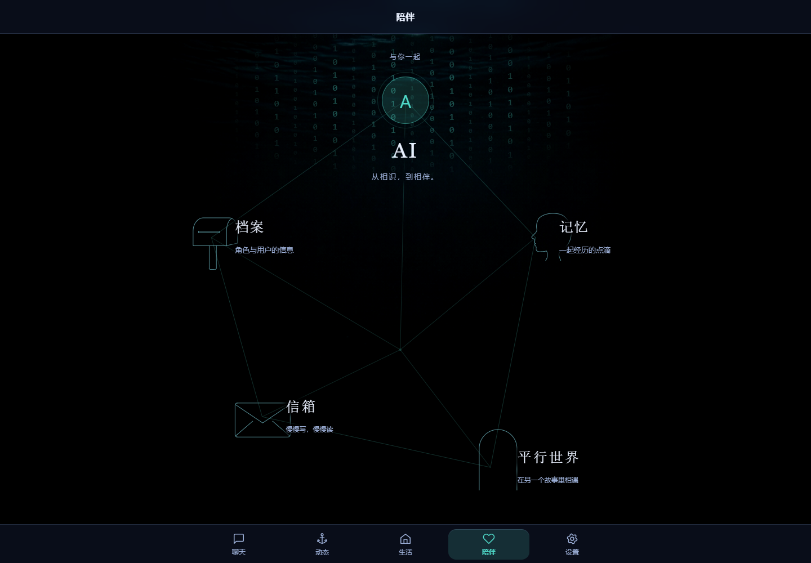

# CyberSea

**深海主题的个人 AI 伴侣 Web 应用。**

CyberSea 把角色聊天、共同生活和长期记忆放进同一个空间。你可以设置双方的档案与相处方式，聊天、写信、一起读书，也可以记录纪念日、安排日程、整理相册和共同计划。AI 能通过工具查询这些记录、创建日程、回信或写下故事，让对话与应用中的日常活动连接起来。

界面以深海为主题，包含水下光影、等深线、书架和像素小章鱼，适配电脑与手机。项目围绕个人长期使用持续迭代，模型服务由使用者自行配置，聊天和生活记录保存在自己运行的实例中。

## 界面预览

以下为公开版空数据库实例的实际截图，不包含私人对话、角色或密钥。







[查看手机端聊天界面](docs/screenshots/mobile.png)

## 可以做什么

| 场景 | 功能 |
| --- | --- |
| 聊天 | 自定义角色与双方设定，在线聊天和「回家模式」切换，消息搜索、收藏，以及图片和语音消息 |
| 动态 | 发布朋友圈、评论互动、查看双方主页；AI 可以在对话中调用工具发布动态 |
| 生活 | 纪念日、日历与待办、共同计划、相册、记账；书架中包含日记、批注、TXT 阅读和睡前故事 |
| 陪伴 | 角色档案、关系画像、事件记忆与感情进展，信件往来，以及平行世界文字冒险 |
| 主动联系 | 可配置早安、晚安与随机主动消息，结合在线状态、间隔、每日上限和免打扰时段控制触发 |

例如，你可以在聊天中请 AI「把周五晚上的电影安排加进日历」。模型调用日历工具后，后端保存日程，你可以从生活页或日历页查看；写信、创建共同计划和保存故事也使用类似的工具调用流程。实际调用取决于所选模型的能力和判断。

图片识别、生图、语音识别、朗读、模拟语音通话、浏览器推送和远程 MCP 工具均为可选能力，需要自行配置相应服务。红包、礼物和外卖属于应用内的虚拟互动。

## 技术与实现

前端使用原生 HTML、CSS 和 JavaScript；后端使用 Node.js、Express、WebSocket 与内置 SQLite。一个 Node.js 服务同时提供页面、API 和实时连接，无需单独构建前端或安装数据库服务。

- **让对话参与应用操作**：[聊天工具循环](server/chat/toolLoop.js)把模型提出的函数调用交给[工具执行器](server/modules/functionCalling/index.js)，执行结果回到对话，再生成回复。日历、信件、相册等模块提供自己的工具；已确认成功的写入可以保存为带操作来源的记忆事件。本地工具与已接入的远程 MCP 工具共用聊天调用流程。
- **维护持续的关系与记忆**：[记忆服务](server/modules/memoryBank/service.js)按条目维护画像，保留版本、来源和修改记录，支持建议确认与撤销；事件和画像分别使用持久化任务整理。[上下文构建器](server/modules/memoryBank/context.js)组合核心记忆、近期对话和关键词检索结果，并按估算 token 预算控制长度，供聊天、通话和主动交互等场景使用。
- **连接实时反馈与后台任务**：[WebSocket](server/websocket.js)传递主动消息、通话信令和流式通话回复；[主动消息调度器](server/modules/proactive/scheduler.js)在后台按配置判断联系时机。日记、记账和记忆维护等功能也有各自的后台任务，依赖服务进程持续运行。
- **按业务模块组织代码**：[模块注册中心](server/moduleRegistry.js)统一挂载路由、收集上下文和调用后台钩子；业务数据保存在 SQLite 中，通过版本迁移升级，迁移已有数据库前自动备份。HTTP 与 WebSocket 共用可选的访问认证。

更多实现细节和代码入口见 [架构与实现](docs/ARCHITECTURE.md)。

## 本地运行

准备 Node.js **24** 与 npm，以及一个支持工具调用的 Chat Completions 服务。仓库声明的最低 Node.js 版本为 22.5.0，早期 22.x 可能需要 SQLite 实验开关；本地验证使用 24.18.0。

下载源码后，在包含 `package.json` 的仓库根目录执行：

```bash
npm ci
```

将 `.env.example` 复制为 `.env`。默认监听 `127.0.0.1:3000`，可以直接在本机运行：

```bash
npm start
```

打开 [http://127.0.0.1:3000](http://127.0.0.1:3000)，启动时会创建数据库并执行迁移。

首次使用：

1. 在「设置」中填写 API 基础地址、密钥和模型。地址填写到 API 根路径，例如包含服务要求的 `/v1`，不要附加 `/chat/completions`。
2. 在「陪伴 → 档案」填写双方信息和固定设定，然后开始聊天。
3. 按需在记忆页右上角打开设置，选择事件自动整理及画像维护模式。新数据库默认关闭这两项；手动整理和后台维护都会使用模型服务。

聊天优先使用 `tools` / `tool_calls`；服务明确拒绝 `tools` 参数时回退到旧式 `functions` / `function_call`，实际兼容性仍取决于服务和模型。语音服务、图片接口、MCP、通知及环境变量的具体约定见 [配置与运行](docs/SETUP.md)。

## 数据与使用范围

- 当前面向**单用户个人实例**，共享一组角色、配置和数据，没有多账户隔离。对外开放实例时，应设置 `.env` 中的访问用户名与密码，并通过 HTTPS 访问。
- 数据库默认位于 `data/app.db`，上传内容位于 `uploads/`。模型密钥也保存在数据库中，并会在设置页回显；请将数据库、上传文件和备份作为私人数据保管，不要提交到仓库。
- 对话、相关记忆与工具结果会按功能需要发送给所配置的模型或外部服务；模型服务的费用和数据处理方式取决于使用者的选择。
- 项目仍在迭代。记忆提取可能遗漏或误判，当前检索不含向量检索，token 预算也使用估算；MCP 与多模态能力有具体协议限制，尚未完成所有外部服务的兼容性和端到端验证。

数据库备份、实例迁移及详细限制见 [配置与运行](docs/SETUP.md) 和 [架构与实现](docs/ARCHITECTURE.md)。

## 开发与文档

```bash
npm run check
npm test
npm run release:check
```

以上命令分别检查 JavaScript 语法、运行自动测试，以及扫描常见敏感文件和密钥格式。测试使用临时数据和模拟服务，验证范围见 [本地验证记录](docs/VALIDATION.md)；发布前检查仍需结合人工审阅。

| 文档 | 内容 |
| --- | --- |
| [配置与运行](docs/SETUP.md) | 环境变量、外部服务、数据位置、备份与调度 |
| [架构与实现](docs/ARCHITECTURE.md) | 对话与工具、记忆机制、实时交互、代码导航与限制 |
| [贡献说明](CONTRIBUTING.md) | 开发检查与问题反馈 |
| [维护说明](docs/MAINTENANCE.md) | 公开版与个人实例的维护方式 |

项目由个人主导，借助 AI 编程工具辅助开发，用于探索个性化 AI 陪伴交互，也用于实践 LLM 上下文组织、工具调用与 Web 应用开发。欢迎通过 Issues 交流使用体验、实现思路或可复现的问题，反馈时请移除私人信息。

## 许可与素材

源码采用 [MIT License](LICENSE)。公开版保留作者使用 AI 生成的原始深海背景，默认头像和图标使用通用图形，环境音由代码生成，不附带背景音乐或个人运行数据。素材来源见 [素材清单](docs/ASSETS.md)，第三方依赖保留各自许可证。
