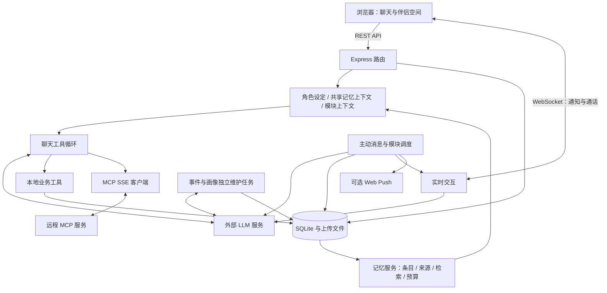

# 架构与实现

以下内容对应当前公开版源码。整体体验见 [项目首页](../README.md)，外部服务约定见 [配置与运行](SETUP.md)。

## 技术架构

| 层次 | 当前实现 |
| --- | --- |
| 前端 | 原生 HTML / CSS / JavaScript，多页面组织；共享导航与请求工具，CSS 变量驱动深海主题 |
| 后端 | Node.js、CommonJS、Express；同一 HTTP 服务提供静态资源、REST API 与 WebSocket |
| 数据存储 | 内置 `node:sqlite` 的 `DatabaseSync`，SQLite WAL；聊天、记忆及业务数据本地持久化，上传文件单独保存 |
| 长期记忆 | Memory V2：条目、版本与来源、事件/画像独立任务、关键词/日期检索，以及按估算 token 预算选择上下文 |
| LLM | 服务端 `fetch` 调用 OpenAI 兼容的 `/chat/completions`；普通回复与 SSE 流式回复分别封装 |
| Function Calling | 业务模块提供工具定义与处理函数，统一注册、分发并回传结果；优先使用新版 tools，明确不支持时回退旧协议，每次聊天最多执行 8 个工具调用 |
| MCP | 自实现远程 SSE + JSON-RPC 客户端，发现工具并转换为聊天函数定义；包含连接缓存、超时与重连处理 |
| 后台交互 | 模块定时任务、聊天后钩子、主动消息调度、WebSocket 广播及可选 Web Push |



### 值得交流的实现

1. **将伴侣行为连接到实际数据操作**

   [系统提示词](../server/chat/systemPrompt.js)与[工具循环](../server/chat/toolLoop.js)分离。模型提出函数调用后，后端执行工具并把结果追加到对话，再继续生成回复；工具错误也作为结果返回。[工具执行器](../server/modules/functionCalling/index.js)记录已确认成功的写入操作，在开启动作记忆时生成带操作来源的事件，并通过操作标识避免重试造成重复写入。失败或结果未确认的操作不会被当作成功经历保存。

2. **按条目维护长期记忆**

   [记忆服务](../server/modules/memoryBank/service.js)将关系画像拆为独立条目，统一处理版本检查、来源校验、修改建议和撤销；[后台任务](../server/modules/memoryBank/jobs.js)分别推进事件与画像的处理进度，保存任务状态、失败重试与租约。来源消息被编辑或删除时，依赖它的记忆进入复核流程，避免继续作为有效记忆直接召回。[迁移](../server/database/migrations/002-memory-v2.js)保留旧画像原文并将其设为受保护条目，保留旧事件与里程碑的 ID。

3. **在共享上下文中控制长度**

   [上下文入口](../server/chat/contextBuilder.js)调用[记忆上下文构建器](../server/modules/memoryBank/context.js)，优先保留核心记忆，再按预算选择近期消息和检索结果；[消息归一化](../server/modules/memoryBank/messageNormalizer.js)区分真实对话、导入历史、通知、图片描述和通话记录，避免把重复汇总或通知当作新对话。近期消息先取最多 200 条候选，再按估算 token 数裁剪。工具循环也会限制过长的工具结果，并在配置模型窗口后检查整体长度；这里使用字符估算，不是模型专用 tokenizer，未配置窗口时也无法保证实际请求一定不超限。

4. **用统一模块接口连接业务与聊天**

   [模块注册中心](../server/moduleRegistry.js)负责路由挂载、上下文片段收集、聊天后钩子和调度器启动。工具实现放在各业务模块的 `tools.js` 中，再由工具注册中心显式注册；模块上下文和后台钩子的错误处理尽量避免影响聊天主流程。

5. **让远程工具复用本地调用流程**

   [MCP 客户端](../server/mcpClient.js)调用 `tools/list` / `tools/call`，给工具名添加服务前缀，并转换 `inputSchema` 为函数参数定义。聊天循环统一处理本地工具与远程工具。当前实现依赖 SSE 的 `endpoint` 事件，未实现 stdio、Streamable HTTP 或完整 MCP 初始化协商流程。

6. **实时通道与持久化配合**

   [WebSocket 服务](../server/websocket.js)负责连接心跳、在线状态、通话信令、流式文本及请求打断；[主动消息调度器](../server/modules/proactive/scheduler.js)将消息落库后广播，并按配置发送浏览器通知。主动交互依赖后端进程持续运行。

7. **为个人实例保留基础维护能力**

   [数据库封装](../server/db.js)统一查询接口；[迁移机制](../server/database/migrate.js)记录版本、使用事务，并在升级已有数据库前备份。[访问保护](../server/security/access.js)为 HTTP 与 WebSocket 提供可选 Basic Authentication 和 Origin 检查。这些是个人实例的基础保护，尚不构成多用户权限系统。

## 记忆库

记忆库包含「关系画像」「感情进展」「事件记录」三个页签。角色的固定设定由用户维护；AI 根据对话提出画像条目的新增、修改或归档，不再通过整体重写画像来更新认知。

- **保留原文与修改依据**：条目保存版本、修改前后内容和来源。AI 修改必须引用已提供的消息；用户可以查看来源、接受或拒绝建议，并在没有后续版本冲突时撤销修改。
- **由用户决定更新方式**：画像维护提供「关闭」「仅建议」「自动更新」三种模式。手动维护和默认导入的条目受保护；即使开启自动更新，涉及受保护条目、明显缩短正文或一次修改多条已有内容时，也会转为待确认建议。
- **事件与画像分别整理**：两者使用独立开关、处理进度和持久化任务；失败可以重试，模型输出无效或被截断时不会推进该批次进度。支持手动整理、JSON 导入，以及通过接口按消息范围回填历史。
- **在不同互动中读取记忆**：聊天、回家、语音通话、主动消息和朋友圈共用记忆上下文构建逻辑，组合置顶画像与约定、置顶里程碑、近期对话和按当前话题检索的记忆。
- **按关键词与日期查找**：检索覆盖画像、事件和里程碑，支持分页；SQLite 支持 FTS5 时使用 trigram 全文索引，短查询或不支持 FTS5 时回退到文本匹配。目前不包含向量检索。
- **减少误展示**：记忆页默认隐藏内容，点击小眼睛后显示；重新进入或切到后台时恢复隐藏。该功能用于避免屏幕上误展示私人信息。

首次使用时，在记忆页右上角打开「记忆设置」。新建数据库默认关闭事件自动整理与画像维护，需要自行选择模式、消息阈值和维护间隔；也可以手动发起整理并查看任务进度。记忆整理使用与聊天相同的模型服务，整理任务会产生额外模型请求。

## 代码导航

```text
应用目录/
├── public/                 页面、前端脚本、主题与 Service Worker
├── server/
│   ├── index.js            服务入口
│   ├── chat/               系统提示词、共享记忆上下文入口与工具循环
│   ├── routes/             核心 API 路由
│   ├── modules/
│   │   ├── memoryBank/     记忆条目、版本/来源、维护任务、检索与上下文预算
│   │   └── …              其他伴侣功能模块与各自工具实现
│   ├── database/           数据库迁移
│   ├── security/           访问保护
│   ├── llmClient.js        模型调用
│   ├── mcpClient.js        MCP 接入
│   ├── memory.js           近期消息读取的兼容入口，复用记忆服务
│   └── websocket.js        实时交互与通话
├── scripts/                检查与维护脚本
├── tests/                  核心测试与工具定义样本
├── .env.example            最小环境配置示例
└── package.json            依赖与运行命令
```

## 当前边界

已知限制：

- 单实例共享一组角色、配置和业务数据，没有多账户隔离或细粒度工具权限；模型可执行部分写入和删除操作，适合使用个人或演示数据。
- AI 提取或修订的记忆仍可能遗漏或误判；来源校验、保护条目和修改建议不能代替人工判断。关键词与日期检索可能漏掉不同措辞表达的相关经历，目前不含向量检索。
- 上下文已有估算 token 预算、工具结果限制与窗口检查，但估算并非模型的精确计数；使用者需要按服务设置模型窗口与输出预留。不同互动场景的请求组织仍有差异，尚未完成真实供应商的全面超限验证。
- TTS 通过统一的 `{text}` 接口调用，具体服务可能需要适配；真实模型与语音服务需要使用者自行验证。
- MCP 为有限的 SSE 工具接入；参考图生图、语音及浏览器通知也受服务接口与浏览器支持程度影响。
- 尚未提供性能基准或全面的兼容性验证；界面与后台错误处理仍需在更多场景下完善。
